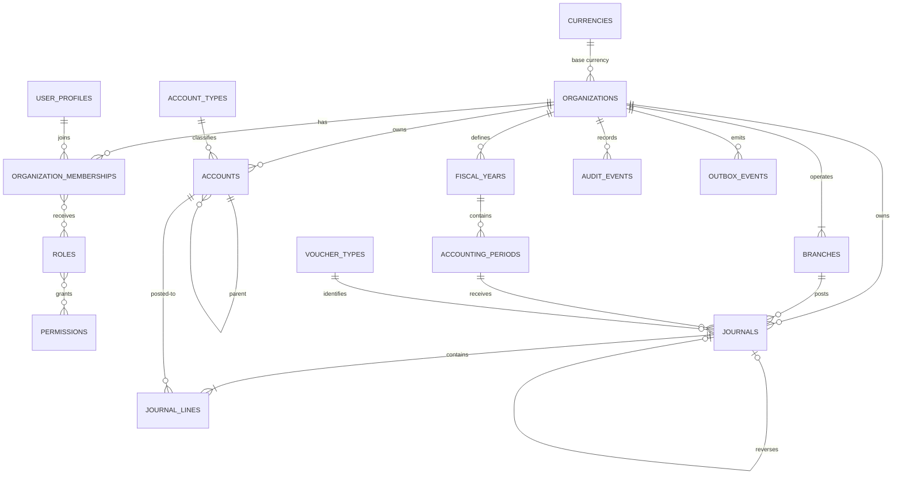

# Database design

The accounting schema is designed for an accrual-based, double-entry general ledger. PostgreSQL is the system of record. Flyway owns all schema changes; Hibernate only validates mappings. The target deployment places this accounting schema in a separate database for each company; platform identity and company routing stay in the control database described in [database-per-company-architecture.md](database-per-company-architecture.md).

## Accounting invariants

- A posted journal has at least two lines and equal debit and credit totals in both transaction and base currency.
- A journal may only be posted into an open period, and its entry date must fall inside that period.
- Posted journal headers and lines are immutable. Corrections use a new reversal voucher linked through `original_journal_id`.
- Account and journal foreign keys include `organization_id`, preventing cross-organization parentage and postings at the database boundary.
- Every journal and voucher sequence belongs to a branch within the same organization. Existing organizations receive a default head-office branch during migration.
- Company and branch updates use optimistic `version` checks. Company and branch records are closed or suspended rather than physically deleted so historical vouchers remain attributable.
- Account hierarchy cycles are rejected, and depth is capped at 20 levels.
- Audit events are append-only. Integration messages use a transactional outbox so a business commit and its event cannot diverge.
- Monetary values use `numeric(24,6)`; rates use `numeric(24,12)`. Application code must use `BigDecimal`, never floating point.

The journal balance checks are deferred until transaction commit. This allows a service to insert or update all voucher lines atomically while preventing any unbalanced posted journal from committing. Voucher number allocation uses `journal_sequences` and must lock its row with `SELECT ... FOR UPDATE`; API commands should also carry an idempotency key when posting or importing.

## Concurrency and tenant isolation

Every mutable aggregate has a `version` column for optimistic locking. Posting services should use one short `READ COMMITTED` transaction, lock the journal and sequence rows, re-check period and approval state, calculate totals, and set the journal to `POSTED`. Database constraints remain the final line of defense.

The checked-in V1-V6 migration lineage represents the current shared-database implementation and uses `organization_id` plus composite tenant-aware foreign keys. It is the source for the controlled migration to database-per-company isolation; its history must not be rewritten. The target tenant schema removes the discriminator because the physical database becomes the tenant boundary. `organization_id` checks remain required until each module has been switched and reconciled.

## Reporting approach

The immutable journal lines are the accounting source. Trial balance, general ledger, balance sheet, and profit-and-loss reports should initially query indexed posted lines. When volume requires it, add period/account balance projections updated from outbox events and retain journal lines as the reconcilable source of truth.

Account types support statement classification and normal balances without hard-coding one country's statutory chart. Organization-level reporting policies, tax, cost centers, projects, and localization should be added as separate modules as their requirements are defined.
